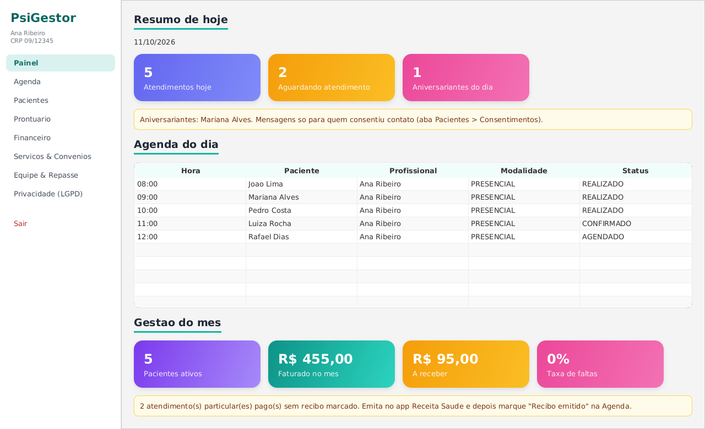
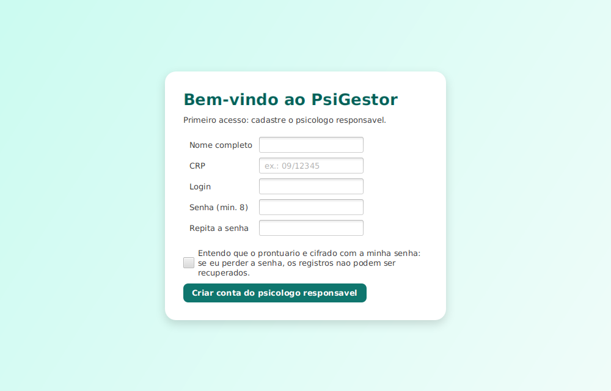
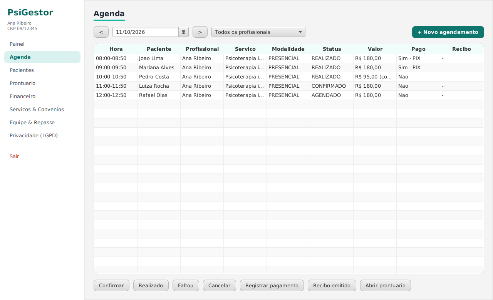
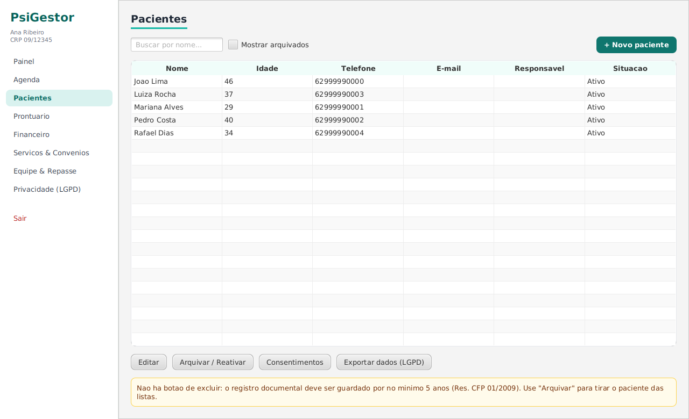
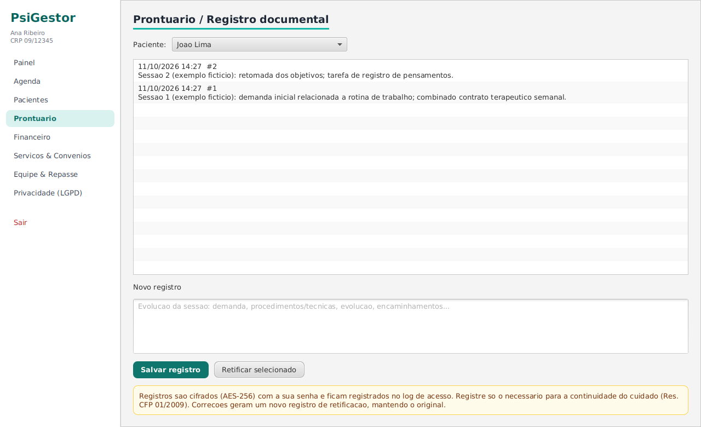
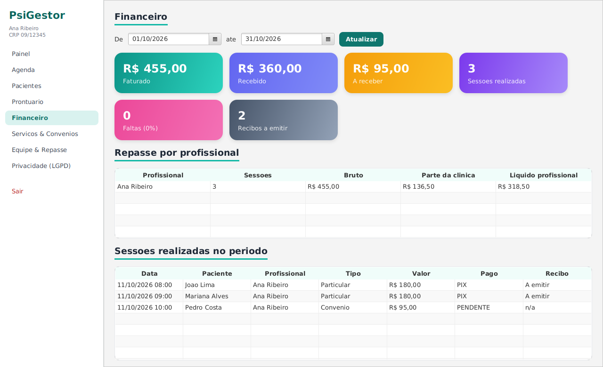
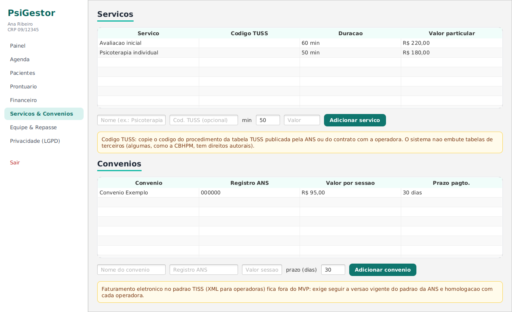
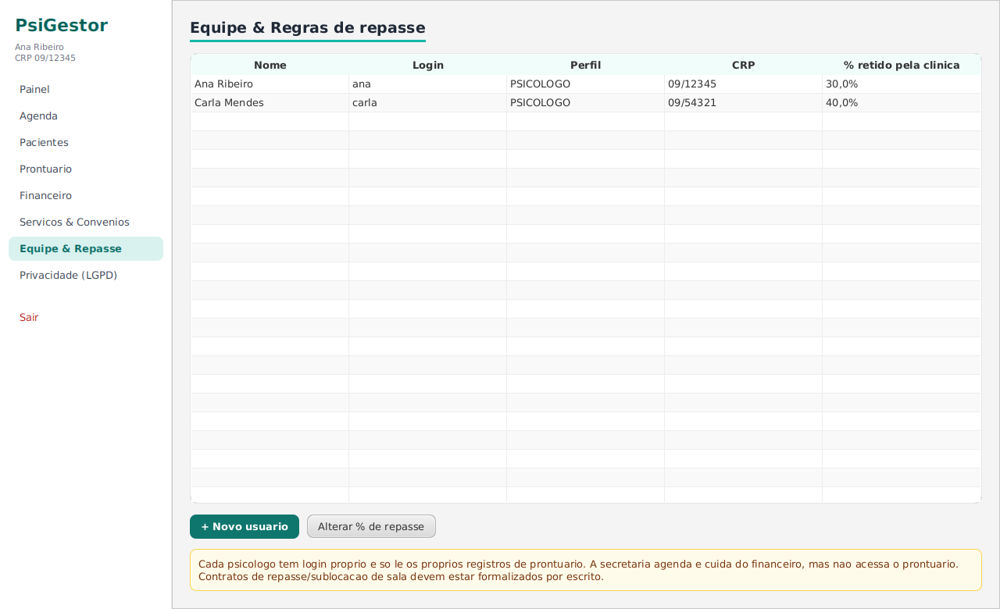
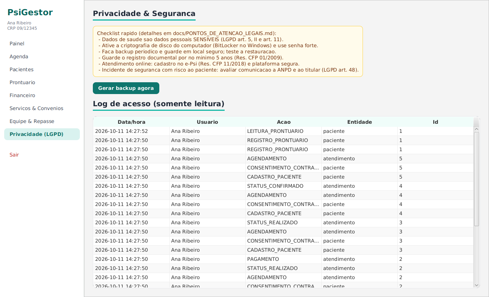
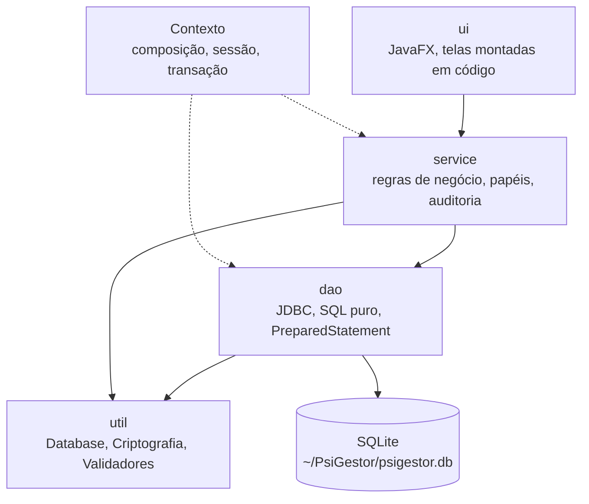

# PsiGestor
✅ 146 testes automatizados · 2 revisões de código independentes · 0 achados críticos ou altos em aberto ([REVISAO.md](docs/REVISAO.md), [REVISAO_FINAL.md](docs/REVISAO_FINAL.md))

Aplicação desktop para **gestão de consultório de psicologia**: agenda, pacientes, prontuário cifrado, financeiro com repasse, cadastros de serviços e convênios, equipe e controles de privacidade (LGPD).

**Stack:** Java 21 · JavaFX 21 · SQLite (JDBC, SQL puro) · JUnit 5 · Maven



## Para quem é e por quê

O público é o psicólogo autônomo ou a pequena clínica, com psicólogos e uma secretaria, que lida com dados de saúde (sensíveis pela LGPD, art. 11) e com sigilo profissional. O projeto parte de uma premissa: o sistema precisa ser seguro por padrão, sem servidor, sem conta em nuvem e sem configuração. Tudo roda localmente, em um único arquivo SQLite, e o conteúdo do prontuário é cifrado com uma chave que só o psicólogo autor consegue abrir.

O objetivo técnico é mostrar um sistema com regras de negócio reais, em camadas bem separadas, com decisões de segurança justificadas e limitações documentadas com honestidade.

## O que o sistema faz

| Módulo | O que faz |
|---|---|
| **Painel** | Visão do dia: atendimentos, aguardando, aniversariantes, faturamento do mês, taxa de faltas, recibos pendentes |
| **Agenda** | Agendamento com checagem de conflito (por profissional e por paciente), máquina de estados do atendimento, forma de pagamento, recibo; atendimento online exige consentimento registrado |
| **Pacientes** | Cadastro com validação de CPF e telefone, responsável legal obrigatório para menores, consentimentos com histórico, arquivamento (sem exclusão), exportação de dados do titular, anonimização após o prazo de guarda |
| **Prontuário** | Evoluções cifradas, append-only; correção só por retificação; registros de outro psicólogo aparecem como sigilosos |
| **Financeiro** | Faturado, recebido, a receber, faltas e repasse por profissional |
| **Serviços & Convênios** | Serviços com código TUSS opcional; convênios com registro ANS e valor por sessão |
| **Equipe & Repasse** | Usuários (psicólogo/secretaria), desativação e reativação, percentual retido pela clínica |
| **Privacidade (LGPD)** | Trilha de auditoria, backup cifrado e restauração, checklist legal |

### Telas

















## Arquitetura

Camadas com dependência em um único sentido. A UI nunca acessa o DAO diretamente: toda operação passa por um service, que valida papel, aplica a regra e audita.



| Pacote | Papel |
|---|---|
| `ui` | Telas JavaFX criadas em código (sem FXML) e estilo em `resources/ui/estilo.css`. Pontos de entrada: `PsiGestorApp` e `Launcher` |
| `service` | Regras de negócio: `AgendaService`, `PacienteService`, `ProntuarioService`, `FinanceiroService`, `CadastroService`, `AutenticacaoService`, `BackupService` |
| `dao` | Acesso a dados com JDBC e `PreparedStatement` |
| `model` | Entidades, enums e records |
| `util` | `Database` (conexão e migrações), `Criptografia`, `Validadores`, `Sessao`, `LogTecnico` |

**Contexto.** É a raiz de composição: cria a conexão, instancia DAOs e services (injeção de dependência manual) e guarda a sessão do usuário logado. Também concentra o controle de inatividade, a auditoria e as transações.

**Migrações.** O esquema (`resources/db/schema.sql`) é aplicado na abertura e a versão fica no próprio arquivo, em `PRAGMA user_version`. Bancos antigos são migrados em transação, de forma idempotente; um banco de versão posterior à do programa é recusado.

**Transações com auditoria.** `Contexto.transacao(...)` executa a operação e o registro em `log_acesso` como uma unidade: ou os dois entram, ou nenhum. A transação é reentrante, então services podem se compor sem abrir transações aninhadas.

**Integridade no banco.** O esquema usa `CHECK`, chaves estrangeiras (`PRAGMA foreign_keys = ON`) e triggers que bloqueiam `UPDATE` e `DELETE` em `evolucao` e em `log_acesso`.

## Segurança e LGPD

Detalhes completos em [docs/POLITICA_DADOS.md](docs/POLITICA_DADOS.md), [docs/REVISAO.md](docs/REVISAO.md) e [docs/PONTOS_DE_ATENCAO_LEGAIS.md](docs/PONTOS_DE_ATENCAO_LEGAIS.md). Resumo das decisões:

- **Criptografia de envelope.** Cada psicólogo tem uma chave de dados (DEK) aleatória de 256 bits, usada em AES-256-GCM com IV novo a cada registro. A DEK fica no banco cifrada por uma chave derivada da senha dele (KEK, PBKDF2-HMAC-SHA256, 600.000 iterações, contagem gravada por usuário). Nenhuma chave existe em código, arquivo ou variável de ambiente. Trocar a senha só reembrulha a DEK, sem recifrar o prontuário.
- **Prontuário append-only.** Triggers impedem `UPDATE` e `DELETE`; correções são feitas por retificação, um novo registro que aponta para o original. A secretaria não tem acesso, e cada psicólogo decifra apenas os próprios registros.
- **Trilha de auditoria.** `log_acesso` registra login, leitura e escrita de prontuário, alterações cadastrais, consentimentos, exportações, backup e restauração. Não guarda conteúdo clínico e é protegido por triggers.
- **Controle de acesso por papel.** `PSICOLOGO` e `SECRETARIA`. Operações sensíveis (cadastros, repasse, exportação, backup, anonimização) exigem psicólogo e são checadas no service. Usuários podem ser desativados, nunca o último psicólogo ativo.
- **Bloqueio de login e inatividade.** Após 5 falhas o login é bloqueado com espera progressiva (30 s dobrando, até 15 min). A sessão encerra após 10 minutos sem atividade. Login inexistente ou inativo paga o mesmo custo de PBKDF2 para dificultar enumeração por tempo de resposta. Senha nova exige no mínimo 12 caracteres.
- **Backup cifrado `.psgb`.** Somente psicólogo. Gerado com `VACUUM INTO`, verificado com `PRAGMA integrity_check` e cifrado com AES-256-GCM, chave derivada de uma senha de backup (PBKDF2, 600.000 iterações, salt por arquivo, cabeçalho autenticado). A senha não é armazenada. A restauração valida senha, integridade e versão do esquema, e preserva uma cópia do banco anterior antes de substituí-lo.
- **Anonimização após o prazo de guarda.** Somente psicólogo, apenas se a data de referência mais recente (último atendimento, último registro de prontuário ou cadastro) tiver mais de 5 anos, com confirmação digitando o nome. Remove nome, CPF, nascimento, telefone, e-mail, contato de emergência, responsável legal e número da carteirinha. O paciente é arquivado e não pode mais ser editado, desarquivado nem agendado. Mantém convênio, vínculos financeiros, consentimentos e o prontuário cifrado. É irreversível no sistema e auditada.
- **Dinheiro em centavos.** Valores trafegam como `long` do schema à UI; o repasse usa `BigDecimal` com `HALF_EVEN`, e a parte da clínica e o valor líquido sempre somam o valor bruto.
- **Exportação do titular.** TXT restrito ao psicólogo, com nome não previsível e sem sobrescrever arquivos existentes, auditada.
- **Erros e logs técnicos.** O usuário vê mensagens genéricas; o log técnico em `~/PsiGestor/logs` guarda apenas classe e pilha.

**O que fica a cargo do BitLocker.** O arquivo `psigestor.db` **não é cifrado pelo aplicativo**: somente o conteúdo do prontuário é. CPF, contatos, agenda e financeiro ficam legíveis a quem copiar o arquivo. A proteção em repouso do banco deve vir do BitLocker (ou da Criptografia de dispositivo do Windows) no disco do consultório, com a chave de recuperação guardada fora do computador. Os backups `.psgb` devem ficar em mídia separada.

## Como rodar

**Requisitos**

| Item | Versão |
|---|---|
| JDK | 21 (`maven.compiler.release` = 21) |
| Maven | 3.9+ |

JavaFX 21.0.5, sqlite-jdbc 3.46.1.3 e JUnit 5.11.3 são baixados pelo Maven. Não há servidor, perfis Maven nem variáveis de ambiente a configurar.

```bash
git clone https://github.com/KleberCS84/PsiGestor.git
cd PsiGestor

mvn javafx:run     # abre o sistema (javafx-maven-plugin 0.0.8, classe br.com.kleber.psigestor.ui.PsiGestorApp)
mvn clean test     # testes JUnit 5 (maven-surefire-plugin 3.5.2), com SQLite em memória
```

`ui.Launcher` é um ponto de entrada alternativo (classe que não estende `Application`), útil para empacotar em um `.jar` único.

**Primeiro acesso.** O sistema pede o cadastro do psicólogo responsável e a definição da senha (mínimo de 12 caracteres). Não há recuperação de senha: **senha perdida significa prontuário irrecuperável**.

**Onde ficam os dados** (`user.home`, ex.: `C:\Users\<voce>\PsiGestor`):

| Caminho | Conteúdo |
|---|---|
| `~/PsiGestor/psigestor.db` | Banco SQLite |
| `~/PsiGestor/logs/` | Log técnico (sem dados de pacientes) |
| `psigestor.db.antes-restauracao-<data>` | Cópia do banco anterior, criada ao restaurar um backup (contém dados em claro; apague quando não precisar mais) |

Arquivos `*.db` estão no `.gitignore`.

## Limitações conhecidas

Itens avaliados e mantidos em aberto de propósito (detalhes em [docs/REVISAO.md](docs/REVISAO.md), seção 4):

- **Ciphertext sem AAD.** Quem puder escrever no `.db` (removendo antes os triggers) pode mover um registro cifrado para outro paciente ou alterar seus metadados sem que a decifragem acuse adulteração.
- **Troca de senha não rotaciona a DEK.** Uma cópia antiga do `.db` ou um backup anterior à troca continua abrindo o prontuário com a senha antiga vazada.
- **Permissões de arquivo padrão.** Banco, backups, logs e exportações herdam a ACL da pasta; outra conta do Windows com acesso à pasta pode copiá-los.
- **Senha e chave em memória.** A `String` digitada na UI e a senha usada no cadastro não são zeradas, e a DEK permanece na memória até o coletor de lixo; um dump de memória do processo pode expô-las.
- **Banco principal sem cifra no aplicativo.** Depende do BitLocker (ver acima).
- **Contador de tentativas de login em memória.** Fechar e reabrir o aplicativo zera o bloqueio, e ele não protege contra ataque offline ao arquivo `.db`.
- **Sem recuperação de senha.** Senha perdida significa prontuário irrecuperável.
- **Eliminação do prontuário não decidida nem implementada.** A anonimização não toca o prontuário, e os triggers impedem apagá-lo.
- **Anonimização parcial.** `convenio_id` e a observação livre dos consentimentos não são alterados. Backups feitos antes da anonimização ainda contêm os dados originais.
- **Restauração de backup** devolve o estado da data do backup: as senhas daquela data, usuários desativados depois dela de novo ativos e pacientes anonimizados depois dela de novo identificados. O sistema só avisa antes de restaurar; é preciso revisar a Equipe e refazer as anonimizações.
- **Metadados do prontuário em claro** (paciente, profissional, data), que revelam frequência e cronologia.
- **Auditoria sem encadeamento de hash.** Quem tem acesso ao arquivo pode remover os triggers do log; leitura e pesquisa de cadastros e agenda não são auditadas.
- **Conexão JDBC única e não sincronizada.** Segura enquanto tudo roda na thread JavaFX; uso futuro de threads de fundo exigirá sincronização.

## Documentação

- [docs/MODELAGEM.md](docs/MODELAGEM.md): modelagem do banco
- [docs/POLITICA_DADOS.md](docs/POLITICA_DADOS.md): anonimização, guarda, backup e exportação
- [docs/REVISAO.md](docs/REVISAO.md): revisão de código, achados e limitações
- [docs/PONTOS_DE_ATENCAO_LEGAIS.md](docs/PONTOS_DE_ATENCAO_LEGAIS.md): pontos legais e éticos

Não substitui orientação jurídica nem do conselho profissional.
