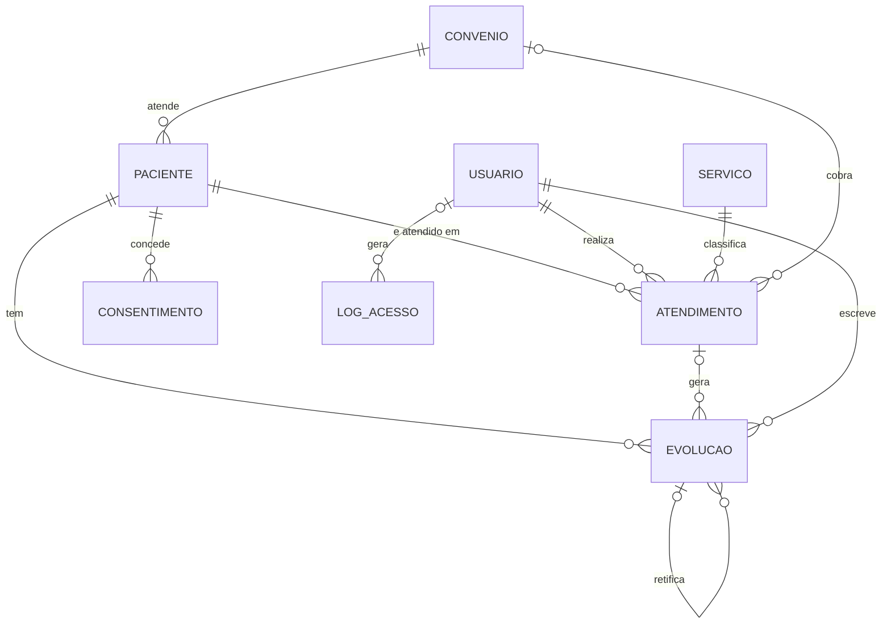

# Modelagem de dados — PsiGestor

Notação de cardinalidade **(mín, máx)**. O esquema físico está em `src/main/resources/db/schema.sql`.

## Entidades e relacionamentos

| Relacionamento | Lado A | Lado B | Leitura |
|---|---|---|---|
| Paciente **possui** Convênio | Paciente (0,1) | Convênio (0,N) | paciente tem no máximo um convênio; convênio atende vários pacientes |
| Paciente **é atendido em** Atendimento | Paciente (0,N) | Atendimento (1,1) | |
| Usuário(psicólogo) **realiza** Atendimento | Usuário (0,N) | Atendimento (1,1) | |
| Serviço **classifica** Atendimento | Serviço (0,N) | Atendimento (1,1) | |
| Paciente **tem** Evolução (prontuário) | Paciente (0,N) | Evolução (1,1) | |
| Atendimento **gera** Evolução | Atendimento (0,N) | Evolução (0,1) | registro pode existir sem sessão (ex.: contato com escola) |
| Evolução **retifica** Evolução | (0,N) | (0,1) | autorrelacionamento |
| Paciente **concede** Consentimento | Paciente (0,N) | Consentimento (1,1) | histórico — nunca sobrescreve |
| Usuário **gera** LogAcesso | Usuário (0,N) | LogAcesso (0,1) | null quando login falha com usuário inexistente |



## Regras de integridade (aula de Modelo Relacional na prática)

| Regra | Como foi implementada |
|---|---|
| Integridade de entidade | `id INTEGER PRIMARY KEY AUTOINCREMENT` em todas as tabelas |
| Integridade referencial | `REFERENCES ... ON DELETE RESTRICT` (bloqueio) — não se apaga paciente com atendimento |
| Substituição por NULL | `paciente.convenio_id ... ON DELETE SET NULL` |
| Domínio | `CHECK (status IN (...))`, `CHECK (valor >= 0)`, `CHECK (fim > inicio)` |
| Chave candidata | `UNIQUE` em `usuario.login`, `paciente.cpf`, `convenio.nome` |
| Regra de negócio no banco | Triggers `trg_evolucao_sem_update/delete` e `trg_log_sem_update/delete` |
| Regra de negócio na aplicação | Conflito de horário, menor com responsável, CPF válido, online com consentimento (camada `service`) |

## Chave do prontuário: criptografia de envelope (v1)

| Coluna em `usuario` | O que guarda |
|---|---|
| `chave_salt` | salt para derivar a **KEK** (chave de embrulho) da senha com PBKDF2 |
| `chave_cifrada` | a **DEK** (chave de dados que cifra o prontuário) cifrada com a KEK (AES-GCM) |
| `chave_iv` | IV usado para cifrar a DEK |

- Trocar a senha = desembrulhar a DEK com a senha antiga e embrulhar com a nova → **1 UPDATE em `usuario`**. A tabela `evolucao` não é tocada (os triggers continuam proibindo UPDATE).
- Usuário criado antes da v1 tem `chave_cifrada = NULL`: no primeiro login, a chave antiga (derivada da senha) vira a DEK e é embrulhada.
- Migração: o `Database` lê `PRAGMA user_version`; se for 0, adiciona as colunas com `ALTER TABLE` (dentro de uma transação) e grava `user_version = 1`.

> Detalhe SQLite: chaves estrangeiras vêm **desligadas**; `Database` executa `PRAGMA foreign_keys = ON` ao conectar.

## Consulta de conflito de agenda (sobreposição de intervalos)

Dois intervalos `[a, b)` e `[c, d)` se sobrepõem quando `a < d AND c < b`:

```sql
SELECT COUNT(*) FROM atendimento
 WHERE profissional_id = ? AND status <> 'CANCELADO'
   AND inicio < :novo_fim AND fim > :novo_inicio;
```
